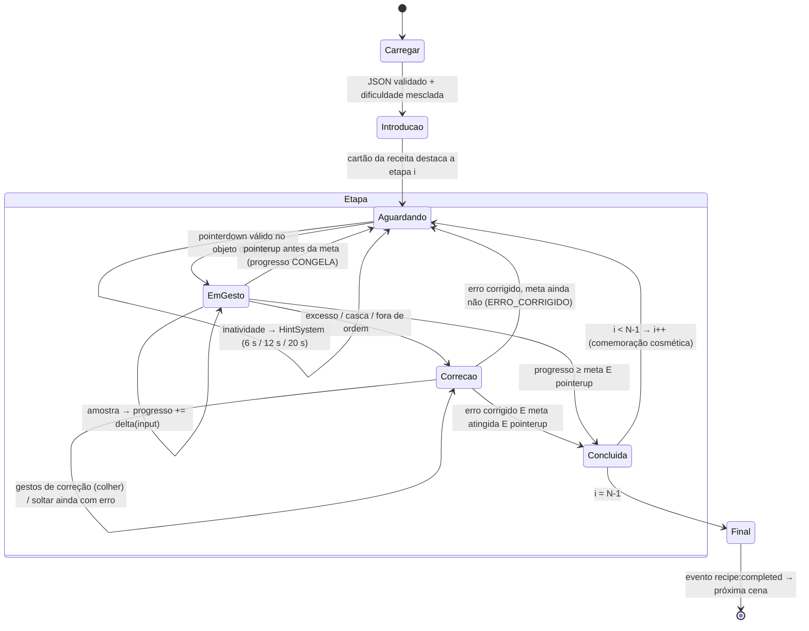

# Meu Bolinho — Documento de Arquitetura (Etapa 1)

> Status: **aprovado** (Etapa 1). Atualizado no Milestone 1 com as decisões tomadas na implementação (ver §12).

## 1. Princípio central: ZERO AUTO-COMPLETE

Toda etapa expõe um único número `progresso ∈ [0, 1]` que **só** pode ser alterado por um
reconhecedor de gesto alimentado por input real do ponteiro. A regra é imposta pela arquitetura, não
pela disciplina de cada desenvolvedor:

| Garantia | Como é imposta |
|---|---|
| Progresso só muda com input | `StepController.progress` é privado; o único método que o altera é `applyInput(delta, source: GestureSample)`. O `GestureSample` só é criado pelo `GestureSystem` a partir de `PointerEvent`s. |
| Input parou → progresso parou | Os reconhecedores são **puros por amostra**: produzem delta a partir de (amostra anterior, amostra atual). Sem amostra nova, delta = 0. Nenhum `update()` integra velocidade "residual". |
| Sem tween que conclui ação | Tweens só são permitidos para **feedback cosmético reversível** (brilho, mascote, item voltando à mesa). Lint customizado (`no-restricted-syntax`) proíbe `tweens.add` dentro de `/src/systems/steps/**`. |
| Sem snap ao resultado | A transição de etapa exige `progress >= meta` **e** `pointerup` (a criança "termina" o gesto). O visual (massa lisa, nível do copo) é função de `progress`, nunca de tempo. |
| Teste de aceite | Teste unitário genérico: para cada tipo de etapa, alimenta N amostras, para, avança 10 s de relógio simulado → `progress` idêntico. |

Exceções explícitas e intencionais (aprovadas na especificação): o **crescimento do bolo no forno**
corre por tempo, mas só depois que a criança fechou a porta e girou o timer; e a retirada exige luva.

## 2. Visão geral em camadas

```
┌───────────────────────────────────────────────────────────────┐
│ Cenas Phaser (apresentação)                                   │
│ Boot → Preload → Menu → Perfis → Trilha → Cozinha → Forno     │
│        → Confeitar → Resultado → Galeria                      │
├───────────────────────────────────────────────────────────────┤
│ RecipeRunner (FSM data-driven)  ←  recipes/*.json + difficulty│
│   └─ StepController por tipo (despejar, mexer, quebrar_ovo…)  │
├───────────────────────────────────────────────────────────────┤
│ Sistemas (EventBus tipado)                                    │
│ Gesture · Fill · Coverage · Hint · Feedback · Audio · Save    │
├───────────────────────────────────────────────────────────────┤
│ Núcleo puro (sem Phaser, 100% testável em Vitest)             │
│ angularAccumulator · pourFlow · coverageGrid · fsm · shake    │
└───────────────────────────────────────────────────────────────┘
```

A camada inferior é **TypeScript puro**: recebe números, devolve números. É ela que os testes
cobrem (acumulador angular, vazão, cobertura, FSM). As cenas apenas desenham o estado.

## 3. Estrutura de pastas

```
meu-bolinho/
  src/
    main.ts                      # Phaser.Game, Scale FIT, 1280×720 lógico
    scenes/                      # uma classe por cena
    systems/
      events/EventBus.ts         # emitter tipado (mapa de eventos)
      gesture/                   # recognizers/*.ts (puros) + GestureSystem.ts (adapta Pointer)
      fill/  coverage/  hint/  feedback/  audio/  save/
      steps/                     # StepController base + um por tipo de etapa
      recipe/RecipeRunner.ts     # FSM da receita
    entities/                    # Ingredient, Container, Bowl, Pan, Oven (view + colisor)
    data/
      recipes/chocolate.json  baunilha.json
      difficulty.json
      schema/recipe.schema.ts    # validação em runtime (zod-like, sem dependência pesada)
    config/                      # constantes de layout, cores, limites de partículas
    utils/                       # math (normalizeAngle, lerp, clamp), pool, debug overlay
  assets/ sprites/ atlas/ sfx/ voice/
  tests/                         # Vitest, sem navegador
```

## 4. FSM de cenas

```mermaid
stateDiagram-v2
    [*] --> Boot
    Boot --> Preload : config + dispositivo detectado
    Preload --> Menu : atlas/áudio carregados
    Menu --> Trilha : "Jogar" (com jogador escolhido)
    Menu --> Perfis : "Jogar" sem jogador / tocar no avatar
    Perfis --> NovoPerfil : "+ Novo jogador" (ou nenhum perfil)
    NovoPerfil --> Trilha : bichinho + nome
    Perfis --> Trilha : tocar num perfil
    Menu --> Galeria : tocar "Galeria"
    Menu --> AreaPais : segurar 2 s (cadeado)
    AreaPais --> Menu
    Trilha --> Cozinha : fase liberada + dificuldade escolhidas
    Cozinha --> Forno : próxima etapa é "forno"
    Forno --> Confeitar : próxima etapa é "decorar"
    Confeitar --> Resultado : criança toca "Pronto!" (só aparece após cobertura ≥ meta)
    Resultado --> Galeria : salvar bolo
    Resultado --> Trilha : estrelas registradas; próxima fase liberada
    Resultado --> Menu
    Galeria --> Menu

    state Pausa <<choice>>
    Cozinha --> Pausa : segurar ⏸ 2 s
    Forno --> Pausa : segurar ⏸ 2 s
    Confeitar --> Pausa : segurar ⏸ 2 s
    Pausa --> Menu : "Sair"
    Pausa --> Cozinha : "Continuar" (retorna à cena de origem)
```



Observação: "Pronto!" no Confeitar não executa nada — apenas encerra uma etapa **livre** (decoração
é criativa e não tem meta além da cobertura mínima).

**Roteamento data-driven (Milestone 2):** a troca de cena não é fixa no código. `Sessao.CENA_DA_ETAPA`
diz em que cena cada *tipo* de etapa acontece (`despejar`, `quebrar_ovo`, `mexer`, `untar`,
`despejar_massa` → Cozinha; `forno`, `desenformar` → Forno; `decorar` → Confeitar). Quando a próxima
etapa pertence a outra cena, a cena atual faz *fade* e passa a `Sessao` adiante (runner, EventBus,
tigela, forma). A `Sessao` é pura (sem Phaser) e é a mesma usada no teste de aceite da receita
completa. Preload e Área dos pais entram no Milestone 3; Galeria no Milestone 4.

## 5. FSM da receita (RecipeRunner)

O RecipeRunner percorre `receita.etapas[]`. Cada etapa passa pelos mesmos sub-estados; o que muda é o
`StepController` instanciado a partir de `etapa.tipo`.



Regras da FSM (testadas unitariamente):

- `Concluida` só é alcançável por `pointerup` a partir de `EmGesto` ou `Correcao` (nunca de `Aguardando`, nunca por timer).
- `Correcao` bloqueia avanço até a condição de erro voltar a zero (ex.: nível ≤ alvo + tolerância).
  Se o erro sumiu mas a etapa ainda não terminou (ex.: casca retirada, falta o 2º ovo), o
  `pointerup` gera `ERRO_CORRIGIDO` e a FSM volta para `Aguardando` (a colher sai de cena).
- Transições inválidas lançam erro em dev e são ignoradas em produção.
- A FSM é um `reducer` puro: `next = transition(state, event)`, facilitando teste e debug.

### Tipos de etapa e seu critério de conclusão

| `tipo` | Reconhecedor | Progresso | Conclusão |
|---|---|---|---|
| `despejar` | Drag + Tilt | nível do alvo / `quantidade` | `|nível − alvo| ≤ tolerância` e pointerup |
| `quebrar_ovo` | Drag até a borda + Tap (cooldown 300 ms) | ovos abertos / `quantidade` | todos abertos e sem casca na tigela |
| `mexer` | Rotação circular | voltas / `voltas` | voltas ≥ meta |
| `untar` | Pincel | cobertura da grade 32×32 | cobertura ≥ `cobertura` |
| `despejar_massa` | Drag + Tilt (viscoso) | 1 − nível da tigela | tigela < 5% |
| `forno` | Drag → Tap porta → Rotação (≤ 1 volta) → *assar por tempo* → Tap porta → Drag luva → Drag forma | fases | forma solta na bancada, com luva |
| `desenformar` | Drag prato + Swipe ↓ | — | swipe com dist ≥ 150 px e vel ≥ 0,6 px/ms |
| `decorar` | Pincel (cobertura) → Drag de enfeites + Shake (granulado) | cobertura da grade | cobertura ≥ `cobertura` e toque em "Pronto!" |

Pegar ingrediente (drag & drop) não é uma etapa própria: faz parte de `despejar` (ingrediente fora
de ordem é rejeitado ao ser solto sobre a tigela).

## 6. Formato de dados

`data/recipes/fofinho.json` (a receita do Milestone 2):

```json
{
  "id": "fofinho",
  "nome": "Bolo Fofinho",
  "corMassa": "#EBC57E",
  "etapas": [
    { "tipo": "despejar", "item": "farinha", "alvo": "tigela", "quantidade": 1.0 },
    { "tipo": "despejar", "item": "acucar", "alvo": "tigela", "quantidade": 0.5 },
    { "tipo": "quebrar_ovo", "quantidade": 2 },
    { "tipo": "despejar", "item": "leite", "alvo": "tigela", "quantidade": 0.75 },
    { "tipo": "despejar", "item": "fermento", "alvo": "tigela", "quantidade": 0.25, "apenas": "confeiteiro" },
    { "tipo": "mexer" },
    { "tipo": "untar", "alvo": "forma" },
    { "tipo": "despejar_massa", "alvo": "forma" },
    { "tipo": "forno", "tempoSegundos": 20 },
    { "tipo": "desenformar" },
    { "tipo": "decorar", "corCobertura": "#5A3220" }
  ]
}
```

Campos por tipo (todos opcionais, exceto onde indicado; os demais vêm da dificuldade ou de
`config/gameplay.ts`):

| tipo | campos |
|---|---|
| `despejar` | `item` (obrigatório, chave de `ingredients.json`), `quantidade` (obrigatório), `tolerancia`, `alvo` |
| `quebrar_ovo` | `quantidade` (inteiro, padrão 1); `cascaDeOvo` vem da dificuldade |
| `mexer` | `voltas` |
| `untar` | `cobertura` (0–1) |
| `despejar_massa` | `restanteMax` (0–1, padrão 0,05) |
| `forno` | `tempoSegundos` (15–25, padrão 20) |
| `desenformar` | — |
| `decorar` | `cobertura` (0–1), `corCobertura` (#RRGGBB) |

O ovo conta como ingrediente para `maxIngredientes`. Qualquer etapa aceita `"apenas": "facil" | "confeiteiro"`.

`data/difficulty.json` — valores que **omitidos** na etapa vêm daqui (a etapa pode sobrescrever):

```json
{
  "facil":       { "maxIngredientes": 4, "voltas": 5,  "tolerancia": 0.20, "cascaDeOvo": false, "cobertura": 0.80 },
  "confeiteiro": { "maxIngredientes": 7, "voltas": 10, "tolerancia": 0.08, "cascaDeOvo": true,  "cobertura": 0.90 }
}
```

Mesclagem: `etapaFinal = { ...difficulty[nivel], ...etapa }`; etapas com `"apenas": "<nivel>"` são
filtradas. Isso permite **uma única receita JSON servir os dois modos**. Validação em runtime na
Preload: erro de schema mostra a receita como indisponível (nunca quebra o jogo).

## 7. Sistemas e EventBus

Comunicação apenas por eventos tipados (`EventMap`), nenhum sistema importa outro.

| Evento | Emissor → Ouvintes |
|---|---|
| `gesture:sample {kind, x, y, t, …}` | Gesture → StepController ativo |
| `step:progress {stepIndex, value}` | Step → Feedback, Hint (reseta inatividade), DebugOverlay |
| `step:error {kind: 'excesso' \| 'casca' \| 'ordem' \| 'quente'}` | Step → Feedback, Audio (fala do mascote) |
| `step:completed {stepIndex}` | RecipeRunner → Feedback, Audio, SaveSystem (checkpoint) |
| `fill:level {containerId, level}` | Fill → Step, Container view |
| `coverage:changed {surfaceId, ratio}` | Coverage → Step, DebugOverlay |
| `hint:level {0..3}` | Hint → cartão da receita, mão-fantasma, Audio |
| `audio:say {clipId, priority}` | qualquer → Audio (fila, sem sobreposição) |

### Algoritmos centrais (núcleo puro)

**Acumulador angular (mexer e timer do forno)**

```
a = atan2(y − cy, x − cx)
r = dist(p, centro) / raioTigela
se r ∉ [0,30; 0,95]           → descarta, zera prevAngle
d = normalize(a − prevAngle)   // para [−π, π]
se |d| > π/2                   → descarta (salto)
se |d| / dt < ωmin (≈1,5 rad/s)→ descarta (parado/tremor)
acumulado += d                 // sentido livre: horário e anti-horário somam como |…| no fim
voltas = |acumulado| / 2π
```

Contagem por **trechos** (implementada no Milestone 1, ver §12): um trecho é rotação contínua num
mesmo sentido (inversão detectada com histerese de 0,35 rad) e só passa a contar depois de varrer
π; a partir daí conta ao vivo. Linha reta nunca varre π vista do centro, então nunca conta; vai e vem
reinicia o trecho a cada inversão, então nunca conta; dedo parado é filtrado por movimento mínimo
(3 px) e ωmin (0,6 rad/s). Inverter o sentido não faz a barra voltar.

**Vazão por ângulo**

```
θ = clamp(Δx_dedo × k, 0°, 90°)       // k = 90° / 180 px
vazão(θ) = 0                          se θ < 25°
         = Vmax × ((θ − 25)/65)^1,5   caso contrário   // curva suave, controle fino perto do limiar
Vmax: líquidos 0,6/s, pó 0,45/s, massa 0,2/s (unidades de "xícara")
nível += vazão × dt   SOMENTE se bico ∈ colisor da tigela E recipiente não vazio
```

**Cobertura por grade** — grade 32×32 sobre a máscara da superfície; cada pincelada marca as células
cujo centro está a ≤ raio do pincel do segmento (interpolado entre amostras, para pinceladas rápidas
não deixarem buracos). `ratio = células_pintadas / células_válidas` (células fora do formato do bolo
não contam). O RenderTexture é só visual.

**Shake (granulado)** — janela de 600 ms; conta inversões de sinal de velocidade horizontal com
|v| > 0,8 px/ms; ≥ 3 inversões → emite uma "porção" de granulado. Para de sacudir → para de cair.

## 8. Dicas, feedback e UX

- `HintSystem`: timer de inatividade reiniciado por qualquer `step:progress` > 0.
  Nível 1 (6 s) brilho no cartão · Nível 2 (12 s) mão-fantasma **em um objeto-fantasma ao lado** ·
  Nível 3 (20 s) narração. A mão-fantasma é um sprite separado sem colisor e sem acesso ao
  StepController — impossível executar a ação.
- Nenhum estado de derrota existe na FSM.
- Alvos ≥ 64 px lógicos (resolução lógica 1280×720), validados em DebugOverlay.
- Paleta Okabe-Ito como base + formas/ícones distintos (nunca só cor).
- Pausa: segurar 2 s com anel de progresso — aqui o anel é proporcional ao tempo **segurando**, se
  solta, zera.
- Retrato: overlay "gire o celular" e jogo pausado.

## 9. Desempenho

- Resolução lógica 1280×720, `Scale.FIT`, `autoCenter`.
- Um atlas por cena (≤ 2048²), áudio em `.mp3` 64 kbps mono para voz e `.ogg/.mp3` para SFX.
- `ParticlePool` com teto global de 300; partículas além disso reutilizam as mais antigas.
- Cobertura por grade (1024 células) em vez de leitura de pixels.
- Orçamento: build < 8 MB (meta interna 5 MB: código ~1 MB, arte ~2,5 MB, áudio ~1,5 MB).

## 10. Modo debug (tecla D / 3 dedos no mobile em dev)

Overlay com: colisores (tigela, bico, anel válido do mexer em verde/vermelho), voltas acumuladas,
ω atual, ângulo e vazão do recipiente, nível, % de cobertura e grade, estado atual da FSM.

## 11. Testes (Vitest, Node, sem navegador)

- `angularAccumulator`: círculo completo = 1 volta; linha reta ≈ 0; ponto parado = 0; fora do anel =
  0; salto > π/2 descartado; vai e vem ≈ 0; parar no meio congela.
- `pourFlow`: θ < 25° = 0; monotônica crescente; bico fora = nível inalterado; recipiente vazio = 0.
- `coverageGrid`: pincelada cobrindo tudo = 1; metade = ~0,5; células fora da máscara ignoradas.
- `recipeFsm`: sequência válida chega a `Final`; `Concluida` inacessível sem `EmGesto`; `Correcao`
  bloqueia; receita nova só com JSON (teste carrega todos os arquivos de `data/recipes`).

## 12. Decisões

1. **Pasta**: jogo isolado em `meu-bolinho/` dentro deste repositório.
2. **Sentido do mexer** — *ajuste em relação à proposta*: em vez de "rotação contrária subtrai",
   o Milestone 1 usa contagem por trechos (§7). Motivo: com subtração, uma criança que troca de
   sentido vê a barra **voltar**, o que soa como punição. A contagem por trechos atende o mesmo
   critério (vai e vem e linha reta não contam) sem o progresso diminuir. Custo: cada vez que o dedo
   encosta, a primeira meia volta não conta (a barra mostra essa meia volta em verde-claro,
   "quase"). Se preferir a subtração, a troca fica restrita a `AngularAccumulator`.
3. **Ingredientes do modo Fácil**: farinha, açúcar, ovo e leite (o ovo entra no Milestone 2).
   O Confeiteiro chega a 7.
4. **Inclinação**: medida pelo deslocamento horizontal a partir do ponto em que o recipiente
   entrou na zona de despejo (acima da tigela). Dentro da zona o recipiente trava na horizontal,
   para a criança poder inclinar sem tirar o bico de cima da tigela; recuar o dedo 50 px ou sair
   da zona na vertical destrava.
5. **Correção de excesso**: cada colherada retira `quantidade × tolerância`, menos que a largura
   da faixa-alvo, então a colher nunca "pula" a faixa para baixo. A etapa termina ao soltar a
   colher quando o nível já voltou para a faixa.
6. **Testes**: Vitest, ambiente Node, sem navegador.
7. **Ovo (Milestone 2)**: a criança arrasta o ovo da caixa até a beirada da tigela (zona de impacto
   em anel ao redor da borda) e solta; o ovo fica apoiado. Depois, dois toques nele (1º trinca,
   2º abre; toques a menos de 300 ms do anterior são ignorados). No Confeiteiro, cada ovo tem 50%
   de chance de derrubar casca (`CONFIG_OVO.chanceCasca`), retirada com a colher como no excesso.
8. **Forno (Milestone 2)**: a única fase por tempo é "assando", depois de a criança fechar a porta e
   girar o timer uma volta (98% da volta liga, tolerância para dedos pequenos). Durante a pausa o
   forno também para. Depois do apito: abrir a porta, levar a luva até a forma e arrastar a forma
   até a bancada. Tentar pegar a forma sem luva gera o erro `quente` (correção: pegar a luva).
9. **Desenformar (Milestone 2)**: a virada da forma acompanha o dedo (0–150 px para baixo); soltar
   sem distância (150 px), velocidade média (0,6 px/ms) ou com desvio lateral grande desfaz a virada.
10. **Decorar (Milestone 2)**: enfeites livres (confeito, morango, vela) e granulado (porção a cada
    3 inversões rápidas do pote em 600 ms). "Desfazer" remove a última ação inteira (uma porção de
    granulado é uma ação). Máximo de 120 itens. A foto do bolo (Resultado) é um `snapshotArea` do
    enquadramento do bolo, pronta para a galeria do Milestone 4.

## 13. Milestone 3: arte, áudio, narração e dicas

**Arte** (`src/art/ArteProcedural.ts`): cenários, sombra, mão-fantasma, brilho, vapor e pó são
desenhados por código uma vez no Boot e salvos como texturas (chaves em `TEXTURAS`). Trocar por
arte ilustrada = carregar um atlas com as mesmas chaves na Preload; nenhuma cena muda. Objetos
interativos (recipientes, tigela, forma, ovo, forno, bolo) continuam vetoriais porque o desenho
deles depende do estado (nível, inclinação, mistura, cobertura).

**Áudio** (`src/systems/audio`): efeitos e música são sintetizados em WebAudio (0 bytes no build).
Sons contínuos (despejar pó/líquido/massa, mexer, pincel, forno) têm intensidade proporcional ao
input e silenciam sozinhos ~120 ms depois que a cena para de alimentá-los: o som obedece à mesma
regra do jogo. A música abaixa enquanto o mascote fala.

**Narração**: cada fala tem um id em `src/data/falas.json` (teste garante que todo id usado no
código existe). `FilaNarracao` (pura, testada) garante uma fala por vez, sem repetição em eco,
com prioridade para avisos. Fonte da voz, em ordem: `src/assets/voz/<id>.mp3` (carregado
automaticamente pela Preload) → voz pt-BR do sistema (Web Speech) → só o balão. O roteiro de
gravação é gerado por `npm run roteiro` em `docs/ROTEIRO_NARRACAO.md`.

**Dicas** (`HintTimer` puro + `HintPresenter`): o relógio só corre quando a etapa espera input
(aguardando/correção, sem gesto em andamento, com dica disponível — p.ex. não corre com o forno
assando). Qualquer toque, movimento do dedo ou progresso zera. Cada cena implementa
`dicaAtual()`: ficha do cartão, objetos a destacar, demonstração do gesto e fala do nível 3.
A mão-fantasma é uma imagem sem colisor e sem referência aos controladores; nos arrastos ela
leva uma cópia translúcida do objeto (o real não se move).

**Área dos pais**: no menu, segurar o cadeado 2 s. Volumes (geral, música, efeitos), narração e
música liga/desliga, salvos em `localStorage` (leitura tolerante a dado corrompido e a storage
bloqueado). Botões só disparam se o toque começou neles (um dedo que chega "solto" de outra
tela não aciona nada).

## 14. Milestone 4: segunda receita, Confeiteiro, galeria e testes

- **Bolo de Chocolate** (`data/recipes/chocolate.json`): entrou só com dados. Fácil tem 4
  ingredientes (farinha, chocolate, ovo, leite) e 6 voltas; Confeiteiro tem 7 (+ açúcar,
  manteiga, fermento), 10 voltas, tolerância ±8% e casca de ovo. Ingrediente novo (manteiga) =
  entrada em `ingredients.json` + 2 falas em `falas.json`.
- Para isso, duas suposições fixas viraram dados: a mesa calcula as posições para 1–8 potes
  (`posicoesRecipientes`, com prateleira de trás acima de 4) e a cor do bolo assado deriva de
  `corMassa`. O cartão da receita encolhe quando há muitas etapas.
- **Galeria** (`systems/save/Galeria.ts`, puro): o Resultado guarda o bolo automaticamente
  (foto JPEG ~12–40 KB), no máximo 30 (os mais antigos saem; com o armazenamento cheio, saem até
  caber). Apagar na galeria exige segurar a lixeira 2 s. **Progresso**: receitas concluídas por
  modo, mostradas como estrelas no cartão de cada receita.
- **Aceite**: `docs/ACEITE.md` liga cada critério da especificação à sua evidência.
- **Tempo de relógio**: dicas (6/12/20 s) e cozimento usam `performance.now()` (limitado a 1 s
  por frame e zerado ao sair da pausa). O delta do Phaser é suavizado e o da física é limitado a
  50 ms; em aparelho lento eles atrasariam as dicas e o forno em relação ao tempo real.
- **Validação de ordem** das etapas no carregamento da receita (ver `validarOrdem`).

## 15. Trilha de fases, estrelas e mecânicas novas

- **Trilha** (`systems/progresso/Trilha.ts`, puro): a ordem vem de `src/data/trilha.json`
  (receitas fora da lista entram no fim). `montarTrilha` calcula, para cada fase, se está
  liberada (fase 1 sempre; as demais quando a anterior tem ≥ 1 estrela, ou com a preferência
  `liberarFases` da área dos pais), as estrelas e as **novidades** (mecânicas que aparecem pela
  primeira vez nela, via `mecanicasDa`). Estrelas ficam em `meu-bolinho:trilha:v1`; registrar
  guarda sempre o melhor resultado (nunca diminui).
- **Avaliação** (`systems/progresso/Avaliacao.ts`): 1 estrela por terminar, +1 se
  `sessao.excessos === 0` (contado pelo evento `etapa:erro` de excesso), +1 se cobertura final
  ≥ 0,95 e ≥ 3 enfeites. Não há perda de estrela nem fase "reprovada".
- **Etapas novas** (dados: `tipo` no JSON da receita; parâmetros em `difficulty.json`):
  - `bater` → `BeatStep` + `WhiskRecognizer`: conta inversões de direção por eixo com amplitude
    ≥ 40 px, velocidade ≥ 0,35 px/ms e ≥ 110 ms entre batidas; meta `batidas` (12 / 20). Requer
    ovo ou líquido antes (validarOrdem).
  - `rechear` → `FillLayerStep`: espalhar o recheio (`CoverageGrid`, meta de cobertura) e soltar a
    camada de cima; `soltarCamada(dx, dy)` só assenta dentro de 36 px e guarda o deslocamento real
    (sem snap). Requer `desenformar` antes. Cena: Confeitar.
  - `decorar` com `glace` → `DecorStep` em três fases: `cobrir` → `glace` → `enfeitar`.
    `TraceStep` reamostra o desenho (`coracao`, `estrela`, `circulo`, `onda`) a cada 10 px; um
    ponto só conta quando o dedo passa a ≤ tolerância (28 / 18 px); meta `tracado` (80% / 92%).
    O botão "Pronto!" só existe na fase `enfeitar`.
- **Cenas**: `TrilhaScene` (caminho em serpentina, cadeados, estrelas, selo NOVO com ícone da
  mecânica, popup Fácil/Confeiteiro) substitui a antiga SelecaoReceita; o Resultado anima as
  estrelas ganhas e o selo "Fase N liberada!".
- **Testes**: `tests/fases.test.ts` (reconhecedor, controladores, avaliação, trilha real) e
  `tests/e2e/fases.cjs` (liberação, bater, rechear, glacê e estrelas no navegador).

## 16. Perfis de jogador e Mundo 2

- **Perfis** (`systems/save/Perfis.ts`, puro): até 6 perfis {id, avatar, nome opcional}, e qual
  está jogando, em `meu-bolinho:perfis:v1`. `armazenamentoDoPerfil(base, id)` embrulha o
  armazenamento e acrescenta `@<id>` às chaves do jogador (galeria, progresso, trilha); as
  preferências continuam do aparelho. As cenas usam `armazenamentoJogador()` e não sabem de
  perfis. O primeiro perfil herda as chaves antigas (sem sufixo). Apagar um perfil remove as
  chaves dele. Não existe senha nem conta online: não há o que vazar e nada sai do aparelho.
- **Cenas**: `PerfisScene` ("Quem vai jogar?"; com `{ gerenciar: true }` vira a tela da área
  dos pais, com lixeira de segurar 2 s) e `NovoPerfilScene` (bichinho → teclado de letras
  grandes → Pronto). Avatares desenhados com formas (`utils/avatar.ts`).
- **Mundos** (`data/trilha.json` → `{ mundos: [{ nome, fases }] }`): `dividirEmMundos` agrupa as
  fases montadas por `montarTrilha` (a numeração e a liberação continuam sequenciais: a fase 9
  abre quando a 8 termina). `mundoAtual` escolhe o mundo onde está a próxima fase.
- **Etapas novas** (parâmetros em `difficulty.json`: `sacudidas` 8/12, `raladas` 10/16,
  `polvilho` 0,6/0,75):
  - `peneirar` (`SiftStep` + `ShakeRecognizer` com `CONFIG_PENEIRAR`): a peneira já traz a medida;
    cada sacudida com o aro sobre a tigela solta `quantidade/sacudidas`. Fora da tigela o
    reconhecedor é zerado.
  - `ralar` (`GrateStep` + `WhiskRecognizer` só no eixo y, `CONFIG_RALAR`): passadas verticais com
    o pedaço na face do ralador; o pedaço encolhe conforme rala.
  - `decorar` com `polvilhar` (`SprinkleStep` dentro de `DecorStep`, fase `polvilhar` entre o
    glacê e os enfeites): cada sacudida carimba um círculo de 46 px, 70 px abaixo do polvilhador,
    numa `CoverageGrid` do topo do bolo.
- **Testes**: `tests/perfis.test.ts`, `tests/mundo2.test.ts`, receita completa das 16 receitas
  nos dois modos e `tests/e2e/mundo2.cjs`.
