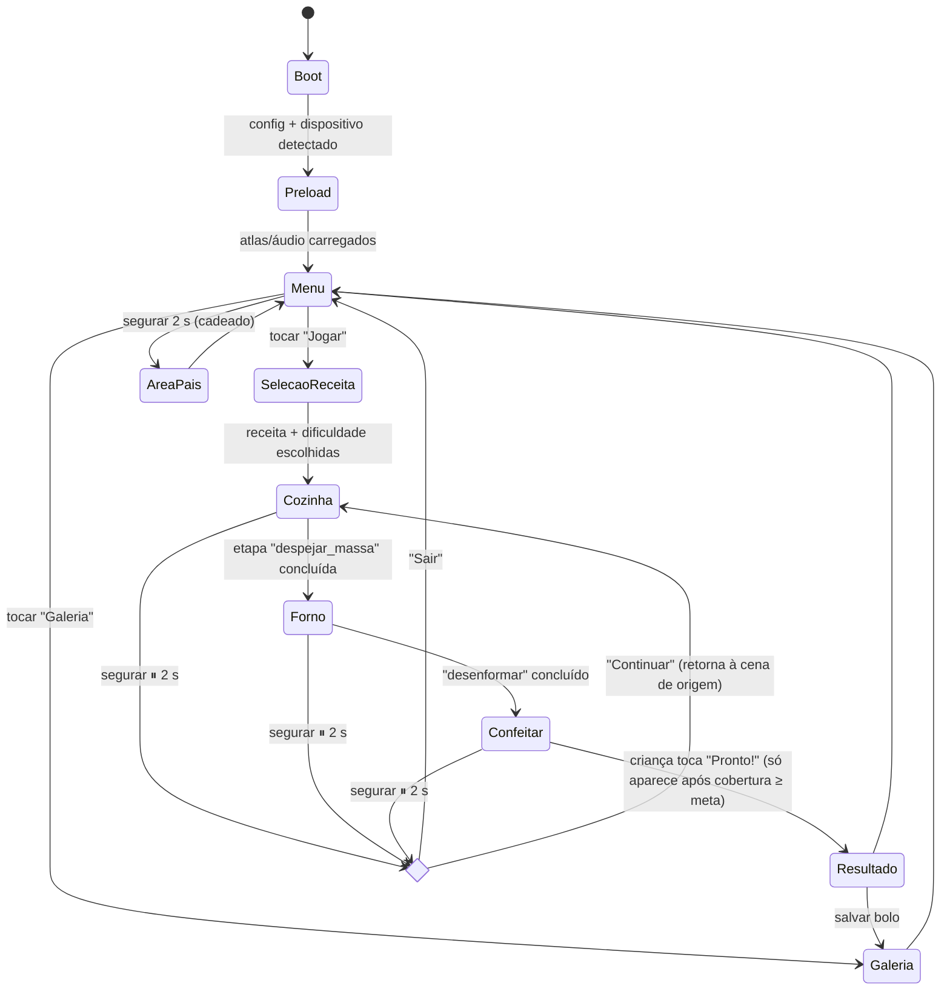
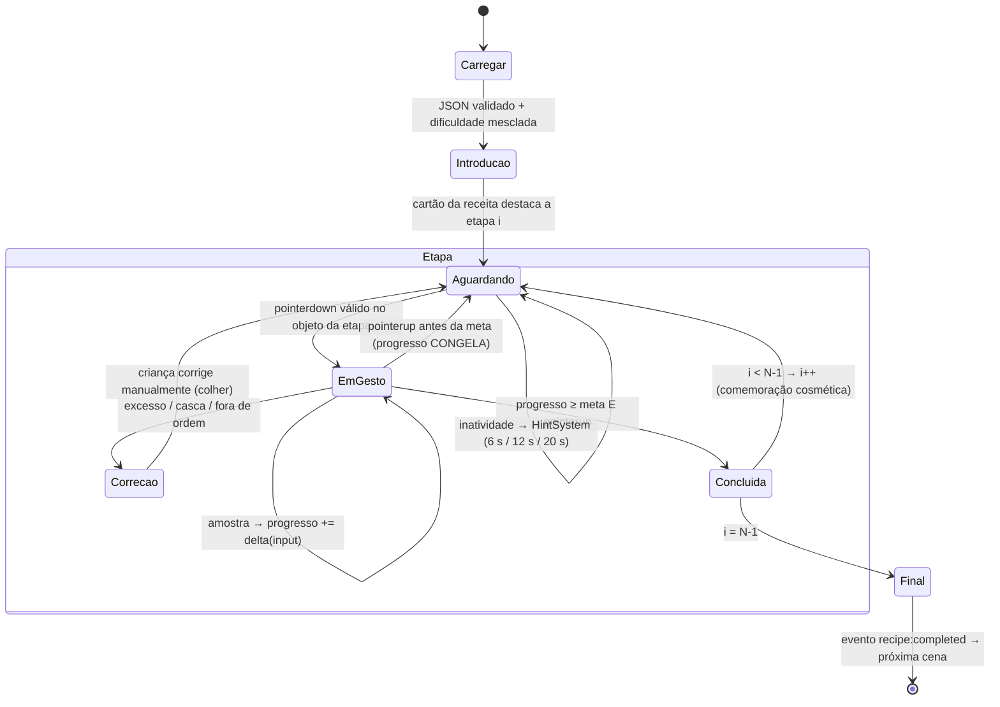

# Meu Bolinho — Documento de Arquitetura (Etapa 1)

> Status: **proposta para validação**. Nenhum código de jogo foi escrito ainda.

## 1. Princípio central: ZERO AUTO-COMPLETE

Toda etapa expõe um único número `progresso ∈ [0, 1]` que **só** pode ser alterado por um
reconhecedor de gesto alimentado por input real do ponteiro. A regra é imposta pela arquitetura, não
pela disciplina de cada desenvolvedor:

| Garantia | Como é imposta |
|---|---|
| Progresso só muda com input | `StepController.progress` é privado; o único método que o altera é `applyInput(delta, source: GestureSample)`. O `GestureSample` só é criado pelo `GestureSystem` a partir de `PointerEvent`s. |
| Input parou → progresso parou | Os reconhecedores são **puros por amostra**: produzem delta a partir de (amostra anterior, amostra atual). Sem amostra nova, delta = 0. Nenhum `update()` integra velocidade "residual". |
| Sem tween que conclui ação | Tweens só são permitidos para **feedback cosmético reversível** (brilho, mascote, item voltando à mesa). Lint customizado (`no-restricted-syntax`) proíbe `tweens.add` dentro de `/src/systems/steps/**`. |
| Sem snap ao resultado | A transição de etapa exige `progress >= meta` **e** `pointerup` (a criança "termina" o gesto). O visual (massa lisa, nível do copo) é função de `progress`, nunca de tempo. |
| Teste de aceite | Teste unitário genérico: para cada tipo de etapa, alimenta N amostras, para, avança 10 s de relógio simulado → `progress` idêntico. |

Exceções explícitas e intencionais (aprovadas na especificação): o **crescimento do bolo no forno**
corre por tempo, mas só depois que a criança fechou a porta e girou o timer; e a retirada exige luva.

## 2. Visão geral em camadas

```
┌───────────────────────────────────────────────────────────────┐
│ Cenas Phaser (apresentação)                                   │
│ Boot → Preload → Menu → SelecaoReceita → Cozinha → Forno      │
│        → Confeitar → Resultado → Galeria                      │
├───────────────────────────────────────────────────────────────┤
│ RecipeRunner (FSM data-driven)  ←  recipes/*.json + difficulty│
│   └─ StepController por tipo (despejar, mexer, quebrar_ovo…)  │
├───────────────────────────────────────────────────────────────┤
│ Sistemas (EventBus tipado)                                    │
│ Gesture · Fill · Coverage · Hint · Feedback · Audio · Save    │
├───────────────────────────────────────────────────────────────┤
│ Núcleo puro (sem Phaser, 100% testável em Vitest)             │
│ angularAccumulator · pourFlow · coverageGrid · fsm · shake    │
└───────────────────────────────────────────────────────────────┘
```

A camada inferior é **TypeScript puro**: recebe números, devolve números. É ela que os testes
cobrem (acumulador angular, vazão, cobertura, FSM). As cenas apenas desenham o estado.

## 3. Estrutura de pastas

```
meu-bolinho/
  src/
    main.ts                      # Phaser.Game, Scale FIT, 1280×720 lógico
    scenes/                      # uma classe por cena
    systems/
      events/EventBus.ts         # emitter tipado (mapa de eventos)
      gesture/                   # recognizers/*.ts (puros) + GestureSystem.ts (adapta Pointer)
      fill/  coverage/  hint/  feedback/  audio/  save/
      steps/                     # StepController base + um por tipo de etapa
      recipe/RecipeRunner.ts     # FSM da receita
    entities/                    # Ingredient, Container, Bowl, Pan, Oven (view + colisor)
    data/
      recipes/chocolate.json  baunilha.json
      difficulty.json
      schema/recipe.schema.ts    # validação em runtime (zod-like, sem dependência pesada)
    config/                      # constantes de layout, cores, limites de partículas
    utils/                       # math (normalizeAngle, lerp, clamp), pool, debug overlay
  assets/ sprites/ atlas/ sfx/ voice/
  tests/                         # Vitest, sem navegador
```

## 4. FSM de cenas



Observação: "Pronto!" no Confeitar não executa nada — apenas encerra uma etapa **livre** (decoração
é criativa e não tem meta além da cobertura mínima).

## 5. FSM da receita (RecipeRunner)

O RecipeRunner percorre `receita.etapas[]`. Cada etapa passa pelos mesmos sub-estados; o que muda é o
`StepController` instanciado a partir de `etapa.tipo`.



Regras da FSM (testadas unitariamente):

- `Concluida` só é alcançável a partir de `EmGesto` (nunca de `Aguardando`, nunca por timer).
- `Correcao` bloqueia avanço até a condição de erro voltar a zero (ex.: nível ≤ alvo + tolerância).
- Transições inválidas lançam erro em dev e são ignoradas em produção.
- A FSM é um `reducer` puro: `next = transition(state, event)`, facilitando teste e debug.

### Tipos de etapa e seu critério de conclusão

| `tipo` | Reconhecedor | Progresso | Conclusão |
|---|---|---|---|
| `pegar` | Drag | — | item solto no colisor do alvo **e** na ordem correta |
| `despejar` | Drag + Tilt | nível do alvo / `quantidade` | `|nível − alvo| ≤ tolerância` e pointerup |
| `quebrar_ovo` | Drag + Tap(cooldown 300 ms) | ovos abertos / `quantidade` | todos abertos e sem casca na tigela |
| `mexer` | Rotação circular | voltas / `voltas` | voltas ≥ meta |
| `untar` / `cobrir` | Pincel | cobertura da grade | cobertura ≥ `cobertura` |
| `despejar_massa` | Drag + Tilt (viscoso) | 1 − nível da tigela | tigela < 5% |
| `forno` | Drag → Tap porta → Rotação (≤ 1 volta) → Drag com luva | sub-etapas | bolo retirado com luva |
| `desenformar` | Drag prato + Swipe ↓ | — | swipe com dist ≥ 150 px e vel ≥ 0,6 px/ms |
| `decorar` | Drag livre + Shake | livre | toque em "Pronto!" |

## 6. Formato de dados

`data/recipes/chocolate.json` (exemplo resumido):

```json
{
  "id": "chocolate",
  "nome": "Bolo de Chocolate",
  "icone": "receita_chocolate",
  "corMassa": "#6B3E26",
  "etapas": [
    { "tipo": "despejar", "item": "farinha", "alvo": "tigela", "quantidade": 1.0 },
    { "tipo": "despejar", "item": "acucar",  "alvo": "tigela", "quantidade": 0.75 },
    { "tipo": "quebrar_ovo", "quantidade": 2 },
    { "tipo": "despejar", "item": "leite",   "alvo": "tigela", "quantidade": 1.0 },
    { "tipo": "despejar", "item": "chocolate_po", "alvo": "tigela", "quantidade": 0.5, "apenas": "confeiteiro" },
    { "tipo": "mexer" },
    { "tipo": "untar", "alvo": "forma" },
    { "tipo": "despejar_massa", "alvo": "forma" },
    { "tipo": "forno", "tempoSegundos": 20 },
    { "tipo": "desenformar" },
    { "tipo": "decorar", "cobertura": "chocolate" }
  ]
}
```

`data/difficulty.json` — valores que **omitidos** na etapa vêm daqui (a etapa pode sobrescrever):

```json
{
  "facil":       { "maxIngredientes": 4, "voltas": 5,  "tolerancia": 0.20, "cascaDeOvo": false, "cobertura": 0.80 },
  "confeiteiro": { "maxIngredientes": 7, "voltas": 10, "tolerancia": 0.08, "cascaDeOvo": true,  "cobertura": 0.90 }
}
```

Mesclagem: `etapaFinal = { ...difficulty[nivel], ...etapa }`; etapas com `"apenas": "<nivel>"` são
filtradas. Isso permite **uma única receita JSON servir os dois modos**. Validação em runtime na
Preload: erro de schema mostra a receita como indisponível (nunca quebra o jogo).

## 7. Sistemas e EventBus

Comunicação apenas por eventos tipados (`EventMap`), nenhum sistema importa outro.

| Evento | Emissor → Ouvintes |
|---|---|
| `gesture:sample {kind, x, y, t, …}` | Gesture → StepController ativo |
| `step:progress {stepIndex, value}` | Step → Feedback, Hint (reseta inatividade), DebugOverlay |
| `step:error {kind: 'excesso' \| 'casca' \| 'ordem' \| 'quente'}` | Step → Feedback, Audio (fala do mascote) |
| `step:completed {stepIndex}` | RecipeRunner → Feedback, Audio, SaveSystem (checkpoint) |
| `fill:level {containerId, level}` | Fill → Step, Container view |
| `coverage:changed {surfaceId, ratio}` | Coverage → Step, DebugOverlay |
| `hint:level {0..3}` | Hint → cartão da receita, mão-fantasma, Audio |
| `audio:say {clipId, priority}` | qualquer → Audio (fila, sem sobreposição) |

### Algoritmos centrais (núcleo puro)

**Acumulador angular (mexer e timer do forno)**

```
a = atan2(y − cy, x − cx)
r = dist(p, centro) / raioTigela
se r ∉ [0,30; 0,95]           → descarta, zera prevAngle
d = normalize(a − prevAngle)   // para [−π, π]
se |d| > π/2                   → descarta (salto)
se |d| / dt < ωmin (≈1,5 rad/s)→ descarta (parado/tremor)
acumulado += d                 // sentido livre: horário e anti-horário somam como |…| no fim
voltas = |acumulado| / 2π
```

Decisão a validar: girar no sentido contrário **subtrai** (|acumulado| reflete rotação líquida).
Isso evita "vai e vem" contar como volta. Linha reta produz d ≈ 0 líquido; toque parado é filtrado
por ωmin.

**Vazão por ângulo**

```
θ = clamp(Δx_dedo × k, 0°, 90°)       // k = 90° / 180 px
vazão(θ) = 0                          se θ < 25°
         = Vmax × ((θ − 25)/65)^1,5   caso contrário   // curva suave, controle fino perto do limiar
Vmax: líquidos 0,6/s, pó 0,45/s, massa 0,2/s (unidades de "xícara")
nível += vazão × dt   SOMENTE se bico ∈ colisor da tigela E recipiente não vazio
```

**Cobertura por grade** — grade 32×32 sobre a máscara da superfície; cada pincelada marca as células
cujo centro está a ≤ raio do pincel do segmento (interpolado entre amostras, para pinceladas rápidas
não deixarem buracos). `ratio = células_pintadas / células_válidas` (células fora do formato do bolo
não contam). O RenderTexture é só visual.

**Shake (granulado)** — janela de 600 ms; conta inversões de sinal de velocidade horizontal com
|v| > 0,8 px/ms; ≥ 3 inversões → emite uma "porção" de granulado. Para de sacudir → para de cair.

## 8. Dicas, feedback e UX

- `HintSystem`: timer de inatividade reiniciado por qualquer `step:progress` > 0.
  Nível 1 (6 s) brilho no cartão · Nível 2 (12 s) mão-fantasma **em um objeto-fantasma ao lado** ·
  Nível 3 (20 s) narração. A mão-fantasma é um sprite separado sem colisor e sem acesso ao
  StepController — impossível executar a ação.
- Nenhum estado de derrota existe na FSM.
- Alvos ≥ 64 px lógicos (resolução lógica 1280×720), validados em DebugOverlay.
- Paleta Okabe-Ito como base + formas/ícones distintos (nunca só cor).
- Pausa: segurar 2 s com anel de progresso — aqui o anel é proporcional ao tempo **segurando**, se
  solta, zera.
- Retrato: overlay "gire o celular" e jogo pausado.

## 9. Desempenho

- Resolução lógica 1280×720, `Scale.FIT`, `autoCenter`.
- Um atlas por cena (≤ 2048²), áudio em `.mp3` 64 kbps mono para voz e `.ogg/.mp3` para SFX.
- `ParticlePool` com teto global de 300; partículas além disso reutilizam as mais antigas.
- Cobertura por grade (1024 células) em vez de leitura de pixels.
- Orçamento: build < 8 MB (meta interna 5 MB: código ~1 MB, arte ~2,5 MB, áudio ~1,5 MB).

## 10. Modo debug (tecla D / 3 dedos no mobile em dev)

Overlay com: colisores (tigela, bico, anel válido do mexer em verde/vermelho), voltas acumuladas,
ω atual, ângulo e vazão do recipiente, nível, % de cobertura e grade, estado atual da FSM.

## 11. Testes (Vitest, Node, sem navegador)

- `angularAccumulator`: círculo completo = 1 volta; linha reta ≈ 0; ponto parado = 0; fora do anel =
  0; salto > π/2 descartado; vai e vem ≈ 0; parar no meio congela.
- `pourFlow`: θ < 25° = 0; monotônica crescente; bico fora = nível inalterado; recipiente vazio = 0.
- `coverageGrid`: pincelada cobrindo tudo = 1; metade = ~0,5; células fora da máscara ignoradas.
- `recipeFsm`: sequência válida chega a `Final`; `Concluida` inacessível sem `EmGesto`; `Correcao`
  bloqueia; receita nova só com JSON (teste carrega todos os arquivos de `data/recipes`).

## 12. Decisões que preciso que você valide

1. **Pasta**: o repositório atual é o NEXUS Optimizer (C#). Proponho manter o jogo isolado em
   `meu-bolinho/`. Prefere um repositório separado?
2. **Sentido do mexer**: rotação contrária subtrai (proposta) ou qualquer sentido soma?
3. **Ingredientes do modo Fácil**: 4 = farinha, açúcar, ovo, leite. Confeiteiro adiciona
   chocolate/fermento/manteiga (7). Ok?
4. **Inclinação**: deslocamento horizontal relativo ao ponto onde o dedo pegou o recipiente
   (proposta), ou relativo ao centro da tigela?
5. **Testes**: Vitest (proposta, integra com Vite).

## 13. Próximo passo

Após sua validação: **Milestone 1** — Vite + Phaser + TS strict, formas geométricas, arrastar,
despejar (com medidor e excesso) e mexer (4 estágios por crossfade de cor), modo debug e os testes
do acumulador angular e da vazão.
